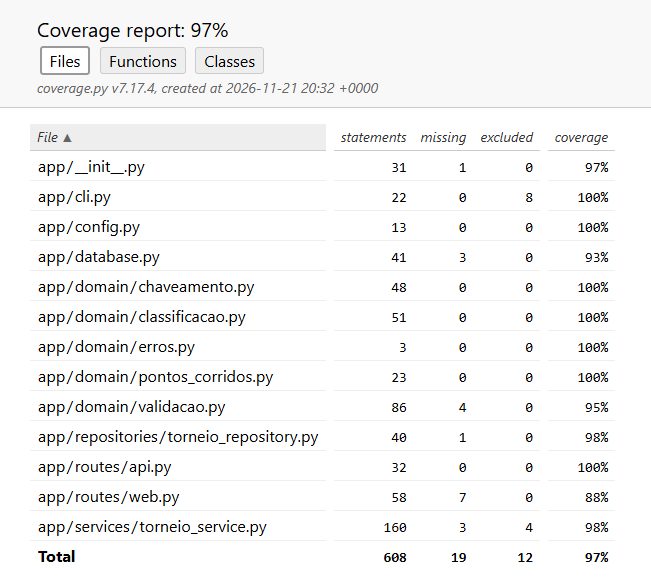
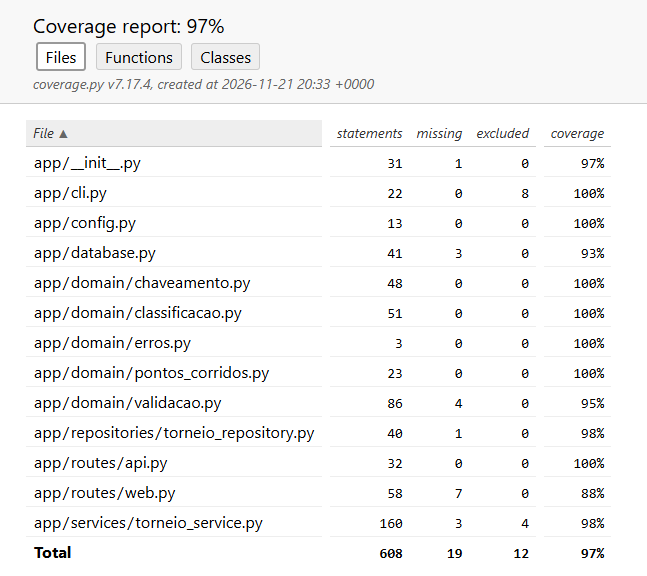
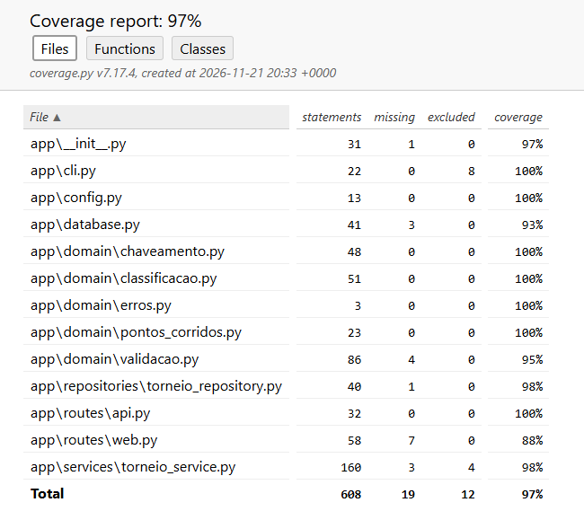

<h1 align="center">⚡ Torneio Relâmpago</h1>

<p align="center">
  <a href="https://github.com/odannyraro/torneio-relampago/actions/">
    
  </a>
  
  
  
  

  
  
  
</p>

---

Sistema web para criação, organização e gerenciamento de torneios em formato relâmpago. Desenvolvido como Trabalho Prático da disciplina de Engenharia de Software II (DCC/UFMG).

- 🌐 **Sistema em produção:** [https://torneio-relampago.onrender.com/](https://torneio-relampago.onrender.com/)
- 🎬 **Vídeo de apresentação:** [Link do Vídeo no YouTube](https://youtu.be/_11DudvyTyk?si=PMTXAVFn8H8mOrwr)
---

## 👥 Integrantes

* **Álvaro Lima**
* **Daniel Rodrigues**
* **Sarah Menks**

---

## 🏆 Sobre o Sistema

O **Torneio Relâmpago** resolve a logística de organizar campeonatos informais e competições de curta duração (FIFA, Mario Kart, Smash, sinuca, truco, etc.), automatizando o fluxo desde a inscrição até a definição do campeão.

### Funcionalidades Principais
- **Criação e Configuração:** Cadastro de campeonatos de 2 a 32 participantes, com opção de sorteio de ordem.
- **Formato Mata-Mata:** Geração automática do chaveamento. Em casos de participantes ímpares ou números que não sejam potência de 2, ajusta automaticamente por folgas (*byes*). O vencedor avança até a final.
- **Formato Pontos Corridos:** Geração do calendário completo todos contra todos (com suporte a turno e returno e folga para número ímpar de participantes). Tabela atualizada dinamicamente com critérios de desempate (vitórias, saldo, gols pró e nome).
- **Gerenciamento de Partidas:** Registro e correção de placares com proteção para integridade do chaveamento.
- **API JSON e Persistência:** Consulta e gestão dos dados via interface web ou API RESTful.

*Mais detalhes de arquitetura, diagramas e modelagem:* [`docs/arquitetura.md`](docs/arquitetura.md).

---

## 🛠️ Tecnologias Utilizadas

| Tecnologia | Descrição / Uso |
| :--- | :--- |
| **Python 3.12 + Flask** | Backend da aplicação, gerenciamento de rotas e regra de negócio |
| **SQLite (`sqlite3`)** | Banco de dados relacional simples e sem necessidade de servidor externo |
| **Jinja2 + CSS** | Renderização das páginas no lado do servidor (*Server-Side Rendering*) |
| **pytest + pytest-cov** | Framework de testes unitários e medição de cobertura |
| **Playwright** | Automação e execução dos testes *end-to-end* (E2E) em navegadores |
| **GitHub Actions** | Matriz de CI/CD para execução automatizada em Linux, macOS e Windows |
| **Render** | Hospedagem em nuvem |

---

## 🤖 Uso de Inteligência Artificial

Ferramentas de IA Generativa foram empregadas no processo de desenvolvimento como suporte para **geração, revisão e correção de código**, operando sob contínua e rigorosa **supervisão e conferência manual humana**.

Toda a tomada de decisão estratégica e o foco central do trabalho foram realizados exclusivamente pelos membros do grupo:
- **Definição de Escopo e Ideação:** Concepção do produto, limites do sistema e regras de negócio.
- **Gestão do Projeto e Versionamento:** Definição da arquitetura, estratégia de *commits* e histórico de código.
- **Engenharia de Testes e Qualidade:** Validação de cenários de teste, garantia de cobertura e automações.
- **DevOps e Infraestrutura:** Configuração do pipeline de CI/CD no GitHub Actions, seleção da hospedagem em nuvem e *deploy* em produção.

O uso de IA atuou como acelerador na escrita de código repetitivo e na sugestão de refatorações, permitindo à equipe focar na aplicação rigorosa das práticas fundamentais de Engenharia de Software propostas pela disciplina.

---

## 📂 Estrutura do Projeto

```
torneio-relampago/
├── app/
│   ├── __init__.py               # Fábrica da aplicação Flask (create_app)
│   ├── config.py                 # Configurações (variáveis de ambiente)
│   ├── database.py               # Conexão SQLite e criação do esquema
│   ├── schema.sql                # Tabelas: torneios, participantes, partidas
│   ├── cli.py                    # Comando flask seed-demo (dados de exemplo)
│   ├── domain/                   # Regras puras (sem Flask, sem SQL)
│   │   ├── chaveamento.py        #   chave de mata-mata e folgas
│   │   ├── pontos_corridos.py    #   calendário todos contra todos
│   │   ├── classificacao.py      #   tabela e desempates
│   │   ├── validacao.py          #   validação de entradas
│   │   └── erros.py              #   exceções de negócio
│   ├── repositories/
│   │   └── torneio_repository.py #  todo o SQL
│   ├── services/
│   │   └── torneio_service.py    #  casos de uso
│   ├── routes/
│   │   ├── web.py                #  páginas HTML
│   │   └── api.py                #  API JSON
│   ├── templates/                # Páginas Jinja2
│   └── static/style.css
├── tests/
│   ├── conftest.py               # Fixtures (banco em memória, app, client)
│   ├── unit/                     # Testes de unidade
│   └── e2e/                      # Testes end-to-end (Playwright)
├── docs/
│   └── arquitetura.md            # Modelagem e arquitetura
├── data/
├── img/
├── .github/workflows/ci.yml      # GitHub Actions
├── requirements.txt / requirements-dev.txt
├── pytest.ini / .coveragerc / .gitignore
├── README.md
└── run_app.sh                    # Cria .venv, instala dependências e executa
```

---

## 💻 Como Executar o Sistema Localmente

### Pré-requisitos
- Python 3.10 ou superior
- Virtualenv (`venv`)

### Execução Automática (Linux / macOS)
```bash
./run_app.sh
```

### Execução Manual (Windows / Linux / macOS)
1. **Crie e ative o ambiente virtual:**
   ```bash
   python -m venv .venv
   
   # No Windows (PowerShell):
   .venv\Scripts\activate
   
   # No Linux/macOS:
   source .venv/bin/activate
   ```

2. **Instale as dependências:**
   ```bash
   pip install -r requirements.txt
   ```

3. **Inicie o servidor de desenvolvimento:**
   ```bash
   flask --app app run --debug
   ```

4. Acesse no navegador: `http://127.0.0.1:5000`

*(Opcional)* Para popular o banco local com dados de exemplo, execute: `flask --app app seed-demo`.

---

## 🧪 Execução dos Testes e Cobertura Localmente

### 1. Instalar dependências de desenvolvimento e navegadores
Antes de rodar os testes pela primeira vez, instale as dependências extras e os binários do Playwright:
```bash
pip install -r requirements-dev.txt
python -m playwright install chromium
```

### 2. Executar Testes Unitários
O projeto conta com **102 testes unitários** testando regras de negócio, validações e rotas:
```bash
python -m pytest tests/unit
```

### 3. Executar Testes End-to-End (E2E)
O projeto conta com **5 testes e2e** automatizados simulando interações de usuários em navegador real via Playwright:
```bash
python -m pytest tests/e2e
```

### 4. Verificar Cobertura de Testes Localmente
Atualmente o projeto atinge **97% de cobertura de código** (requisito mínimo: ≥ 80%). Para rodar os testes unitários gerando o relatório no terminal e checando a meta:
```bash
python -m pytest tests/unit --cov=app --cov-report=term-missing --cov-fail-under=80
```

Para gerar um relatório detalhado em HTML e visualizar no navegador:
```bash
python -m pytest tests/unit --cov=app --cov-report=html
```
O relatório estará disponível na pasta `htmlcov/index.html`.

---

## 🔄 Pipeline CI/CD, Artefatos e Cobertura Multi-OS

O pipeline de Integração Contínua é gerenciado pelo **GitHub Actions** ([`.github/workflows/ci.yml`](.github/workflows/ci.yml)).

### Funcionamento do Workflow:
1. **Matriz Multi-OS:** A cada commit ou pull request, os testes rodam simultaneamente nos três sistemas operacionais: `ubuntu-latest` (Linux), `macos-latest` (macOS) e `windows-latest` (Windows).
2. **Execução Completa:** Validação dos 102 testes unitários e 5 testes E2E em todos os ambientes.
3. **Geração de Artefatos:** Cada runner constrói e exporta o relatório de cobertura em HTML em um pacote zip de artefatos.

### 📊 Como Baixar os Artefatos de Cobertura (HTML):
1. Acesse a página do workflow: [Execuções do GitHub Actions](https://github.com/odannyraro/torneio-relampago/actions/workflows/ci.yml).
2. Selecione a execução mais recente concluída com sucesso (`✅`).
3. Role até a seção **Artifacts** na parte inferior da página e faça o download dos arquivos zip para cada sistema operacional (`cobertura-macos-latest`, `cobertura-ubuntu-latest`, `cobertura-windows-latest`).
4. Descompacte o pacote e abra o arquivo `htmlcov/index.html` no seu navegador.

---

### 🖼️ Comprovação de Cobertura nos Sistemas Operacionais

Abaixo estão as evidências dos relatórios de cobertura gerados e validados nas execuções dos workflows:

#### 🐧 Linux (Ubuntu)


#### 🍎 macOS


#### 🪟 Windows


---

## 🚀 Deploy em Produção

A aplicação é implantada automaticamente na plataforma **Render**. 
- **URL de Produção:** [https://torneio-relampago.onrender.com/](https://torneio-relampago.onrender.com/)
- Ambiente, que em seu plano gratuito, disponibiliza disco efêmero. Dessa forma, reiniciando o sistema web após tempo de inatividade ser atingido, porém esse processo de reinicialização leva menos de 60 segundos.
