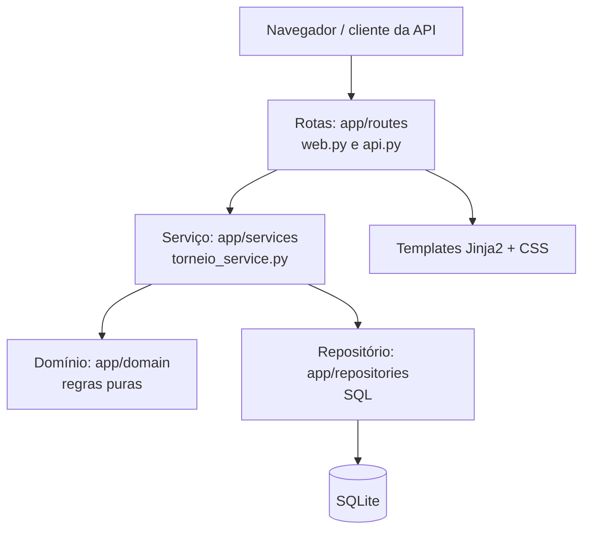
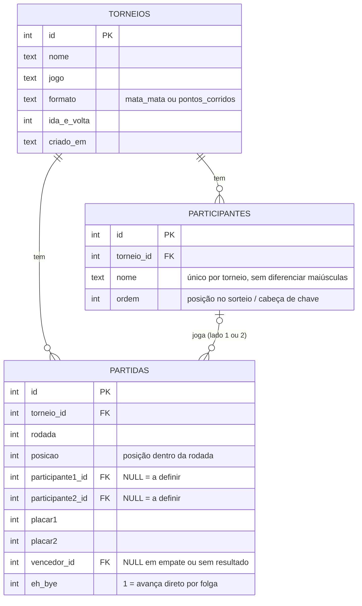
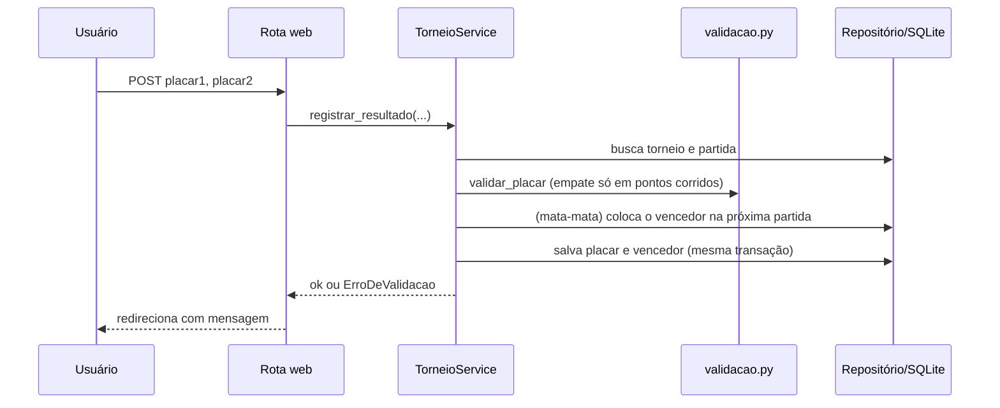

# Arquitetura e modelagem – Torneio Relâmpago

## 1. Visão geral

Aplicação web em **Flask (Python)** com banco **SQLite**, organizada em camadas. Cada camada só conhece a de baixo,
e a lógica de negócio (chaves, calendário, classificação) fica em funções puras, sem Flask e sem SQL.
Isso torna os testes de unidade simples e rápidos.

| Camada | Pasta | Responsabilidade |
|---|---|---|
| Apresentação | `app/routes`, `app/templates`, `app/static` | Receber requisições, mostrar páginas, converter erros em mensagens |
| Serviço | `app/services` | Casos de uso: criar torneio, registrar resultado, consultar, excluir (controla a transação) |
| Domínio | `app/domain` | Regras puras: validação, chaveamento, calendário, classificação |
| Persistência | `app/repositories`, `app/schema.sql`, `app/database.py` | Todo o SQL e a conexão com o SQLite |

## 2. Modelo de dados (SQLite)

Decisões de modelagem:

- **Classificação, campeão e progresso não são gravados**: são calculados a partir das partidas, o que evita dados inconsistentes.
- Em mata-mata, a partida seguinte é encontrada por fórmula (`destino_do_vencedor`), sem coluna extra de "próxima partida".
- Participante `NULL` em uma partida significa "ainda a definir" (esperando o vencedor da fase anterior).

## 3. Algoritmos principais

**Mata-mata (`domain/chaveamento.py`)**
1. O tamanho da chave é a menor potência de 2 maior ou igual ao número de participantes (5 → 8).
2. As cabeças de chave são posicionadas na ordem padrão (`[1, 8, 4, 5, 2, 7, 3, 6]`), para os melhores só se encontrarem nas fases finais.
3. As vagas que sobram viram **folga (bye)**: o participante avança direto, e os melhores cabeças são os beneficiados.
4. O vencedor da posição *p* de uma rodada vai para a posição *p // 2* da próxima, no lado 1 (se *p* é par) ou lado 2 (se *p* é ímpar).

**Pontos corridos (`domain/pontos_corridos.py`)**
- *Método do círculo*: um participante fica fixo e os outros giram a cada rodada. Com número ímpar entra uma vaga fantasma, e quem a enfrentaria folga.
- Com "ida e volta", o returno repete as rodadas invertendo os lados.

**Classificação (`domain/classificacao.py`)**
- Vitória = 3 pontos, empate = 1, derrota = 0.
- Desempate, na ordem: pontos, vitórias, saldo de gols, gols pró, nome (alfabético).

## 4. Fluxo: registrar um resultado

Regra de segurança da chave: corrigir o **vencedor** de uma partida é bloqueado se a partida seguinte já foi jogada;
corrigir só o placar (mantendo o vencedor) é sempre permitido.

## 5. Rotas

| Método | Rota | O que faz |
|---|---|---|
| GET | `/` | Lista os torneios |
| GET/POST | `/torneios/novo` | Formulário e criação |
| GET | `/torneios/<id>` | Chave ou tabela + rodadas |
| POST | `/torneios/<id>/partidas/<pid>/resultado` | Registra/corrige placar |
| POST | `/torneios/<id>/excluir` | Exclui o torneio |
| GET | `/saude` | Verificação para o deploy |
| GET/POST | `/api/torneios`, `/api/torneios/<id>`, `/api/torneios/<id>/partidas/<pid>/resultado` | API JSON |

## 6. Estratégia de testes

- **Unidade (`tests/unit`)**: domínio (chaves, calendário, desempates, validações), serviço com SQLite em memória e rotas com o cliente de teste do Flask.
- **End-to-end (`tests/e2e`)**: Playwright abre um Chromium real contra o app rodando com um banco temporário.
- **Cobertura**: `pytest-cov`, com mínimo de 80% imposto no CI.
